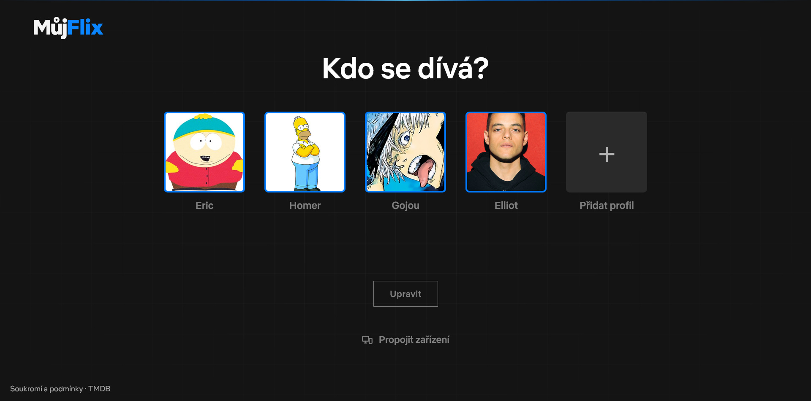
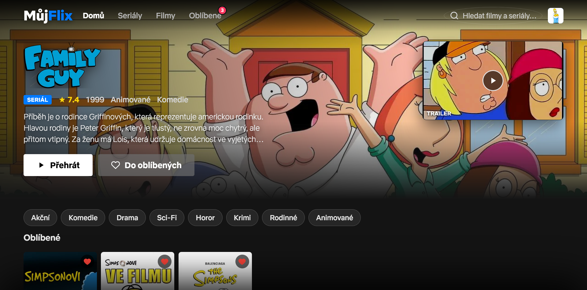
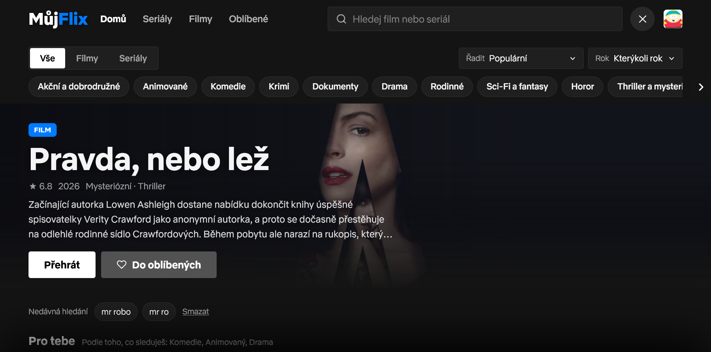
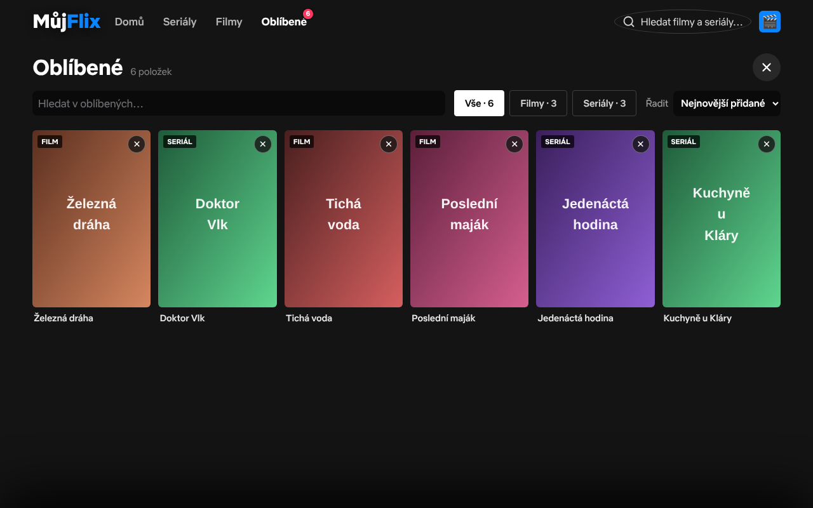
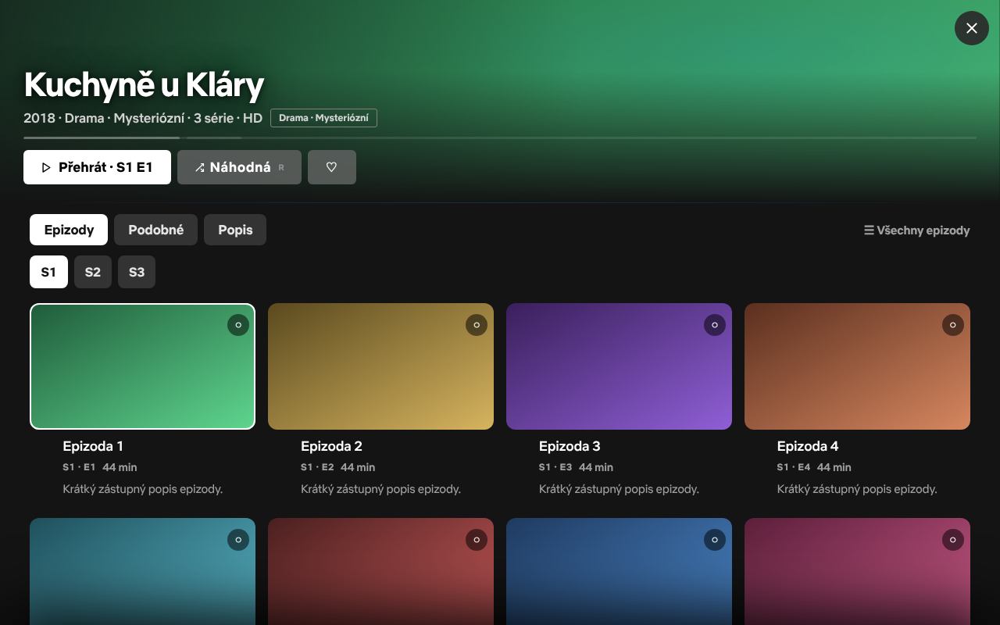
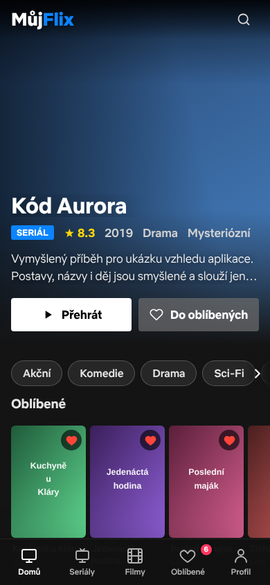
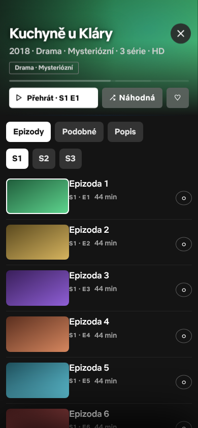

# 🎬 MůjFlix

### Tvůj osobní filmový a seriálový tracker ve stylu Netflixu

Najdi, co sledovat. Pamatuj si, kde jsi skončil. Mějte s rodinou každý svůj profil a seznamy, i na více zařízeních. Bez účtu a bez instalace.

**[👉 Vyzkoušet na mujflix.pages.dev](https://mujflix.pages.dev)**

---

## 🤔 Proč MůjFlix?

Máš rozkoukaných pět seriálů, v hlavě seznam filmů „na někdy“ a večer stejně půl hodiny jen scrolluješ? MůjFlix to řeší:

- 📍 **Ví, kde jsi skončil.** Řada **Pokračovat ve sledování** ukazuje postup a zbývající čas a štítek **Nová epizoda** řekne, že vyšel další díl.
- 🎯 **Doporučí, co sledovat dál.** Řady **Vybráno pro tebe** a **Protože jsi viděl …** se skládají zvlášť pro každý profil a ukazují, z čeho vycházejí (třeba tvé oblíbené žánry nebo titul, který jsi viděl).
- 👨‍👩‍👧 **Každý má svůj profil.** Vlastní jméno, avatar, seznam Oblíbených, volitelně PIN a věkové omezení.
- 🔒 **Žádný účet.** Žádný e-mail, heslo, cookies ani analytika. Tvoje profily a historie zůstávají v tvém prohlížeči.
- 📱 **Telefon, tablet i počítač.** Stačí prohlížeč a dá se přidat na plochu jako aplikace.
- 🎁 **Měsíční Wrapped.** Přehled toho, co jsi za měsíc sledoval, ve stylu příběhu, s obrázkem ke sdílení.

---

## 🚀 Jak začít

**Nic se neinstaluje a nic nemusíš spouštět.**

1. Otevři **[mujflix.pages.dev](https://mujflix.pages.dev)**.
2. Vytvoř si profil (jméno, avatar, barva) nebo vyber existující.
3. Hledej, procházej a přidávej do Oblíbených srdíčkem. Hotovo.

### 📲 Přidání na plochu (volitelné)

Z MůjFlixu se dá udělat „opravdová“ aplikace s vlastní ikonou:

| Zařízení               | Jak                                                       |
|------------------------|-----------------------------------------------------------|
| Android (Chrome)       | menu ⋮ → **Přidat na plochu** / **Nainstalovat aplikaci** |
| iPhone / iPad (Safari) | tlačítko Sdílet → **Přidat na plochu**                    |
| Počítač (Chrome, Edge) | ikona instalace v adresním řádku                          |

---

## 📸 Jak to vypadá

| Kdo se dívá? | Úvodní stránka |
|:---:|:---:|
|  |  |

| Procházení | Oblíbené |
|:---:|:---:|
|  |  |

| Detail seriálu | Na telefonu |
|:---:|:---:|
|  |   |

---

## ✨ Co MůjFlix umí

Navigace je pořád na očích: **Domů · Seriály · Filmy · Oblíbené · Profil**. Na počítači v horní liště vedle loga, na telefonu dole.

### 🏠 Úvodní stránka

- **Banner** s doporučeným titulem, tlačítky **Přehrát** a **Do oblíbených** a řádkem, proč ti ho nabízíme (např. „Podle tvých žánrů: Sci-Fi · Akční“). Řádek se ukáže jen tehdy, když to opravdu víme.
- **Pokračovat ve sledování** s lištou postupu a zbývajícím časem. Co už jsi dokoukal, jde z řady jedním klepnutím schovat.
- **Oblíbené**, **Protože jsi viděl …** a **Vybráno pro tebe**. Dokud appka neví, jaké žánry máš rád, ukáže místo toho **Populární právě teď**.
- **Top 10 tento týden** a **Nejlépe hodnocené seriály / filmy**. V řadách nejlépe hodnocených se nenabízejí tituly, které už jsi viděl.
- Karty ukazují pod názvem rok a hodnocení, např. „2020 · ★ 8.1“.

### 🔎 Procházení a hledání

- **Seriály** a **Filmy** otevřou procházení s filtry podle žánru a roku a řazením podle popularity, hodnocení nebo novosti.
- **Hledání** (lupa nebo klávesa `/`) najde titul podle českého, anglického i původního názvu. Poradí si s překlepy („breking bad“ najde Breaking Bad), zvládne i rok („matrix 1999“) a pamatuje si, co jsi hledal.

### 📺 Detail seriálu

- **Epizody**: výběr sezóny, karty epizod s náhledem, kolečkem ✓ pro označení jako zhlédnuté a štítkem **Další** u epizody, která je na řadě.
- **Podobné seriály**, **Popis** s fakty, **trailerem** (načte se až po klepnutí na přehrávání) a **obsazením**. Klepnutím na herce uvidíš jeho filmografii.
- **Náhodná epizoda** pro seriály s více epizodami.
- **Hodnocení epizod** na pětihvězdičkové škále (od „Katastrofa“ po „Masterpiece“), které vidíš i na kartě epizody.
- **Sdílení odkazem**: tlačítko Sdílet zkopíruje odkaz na titul (nebo otevře sdílení v telefonu). V chatech jako Discord, WhatsApp, Telegram, Facebook, Slack, LinkedIn nebo X se odkaz ukáže s plakátem a popisem.

### ❤️ Oblíbené

- Srdíčko přidá titul do Oblíbených. Najdeš je pod **Oblíbené** v navigaci.
- Záložky **Vše / Filmy / Seriály** s počty, **Rozkoukané**, hledání v oblíbených a řazení (nejnovější přidané, podle abecedy).

### 🎞 Přehrávání a kde to legálně sledovat

- **Kde je titul legálně dostupný:** v přehrávači uvidíš, na kterých streamovacích službách (Netflix, Disney+, Max, SkyShowtime, Voyo, Apple TV+ a další) titul je. Hledá se nejdřív v ČR a SK včetně půjčení a koupě, potom v zahraničí. Odkaz tě pošle rovnou ke službě.
- **Přehrávač** vyhledá titul na externích webech, které MůjFlix nijak neovládá. Pamatuje si, který zdroj ti fungoval, a když zdroj titul nemá, sám přepne na jiný. Pod přehrávačem je výběr epizody, tlačítko **Další** a hodnocení epizody.
- **Dvě skupiny zdrojů:** české a zahraniční (anglicky). Když se titul na českých nenajde, MůjFlix zkusí zahraniční.
- Něco nejde? Klepni na **Zdroj nejde** a MůjFlix zkusí další. U českých zdrojů pomůže **lupa** (hledání titulu přímo na tom webu).
- Některé weby nejde zobrazit uvnitř aplikace, místo toho se ukáže tlačítko **Otevřít v novém okně**.

> ⚠️ **Reklamy:** MůjFlix sám žádné reklamy nezobrazuje, ale přehrávané weby jsou cizí a mohou je i vyskakovací okna zobrazovat. Doporučujeme blokátor reklam. Po vytvoření profilu ti appka nabídne ten vhodný pro tvůj prohlížeč (na telefonu prohlížeč Brave, který reklamy blokuje sám).

### 🎁 Wrapped

Z menu profilu (avatar vpravo nahoře → **Wrapped**) otevřeš měsíční přehled sledování ve stylu příběhu: kolik jsi toho viděl, kdy se díváš a jaký jsi typ diváka (třeba Noční sova nebo Ranní ptáče). Přehled si můžeš uložit jako obrázek (na počítači na šířku, na telefonu na výšku). Počítá se jen z dat ve tvém zařízení.

### 👤 Profily

- **Kdo se dívá?**: každý člen rodiny má vlastní jméno, avatar (včetně postav z anime, seriálů a filmů), barvu, Oblíbené a doporučování.
- **PIN** (4 číslice): po 5 špatných pokusech se profil zamkne a zámek se postupně prodlužuje (od 30 sekund až po 24 hodin).
- **Věkové omezení** (do 7 / 12 / 15 let) skryje tituly nad zvolený věk podle hodnocení z TMDB. Titul bez hodnocení se skryje. Změnit věk jde u profilu s PINem jen s PINem.
- **Zaměření a žánry**: „Jen anime“ nebo až 5 oblíbených žánrů.
- PIN a věkové omezení jsou pojistka pro domácí použití, ne skutečná rodičovská kontrola.

### ⚙️ Nastavení

Avatar vpravo nahoře → **Nastavení**: úprava profilu, zaměření a žánry, a pod **Pokročilé** propojení zařízení, záloha a obnova dat, verze a aktualizace a smazání dat v tomto zařízení (dvoustupňové potvrzení).

### 🔗 Propojení zařízení

Chceš mít profily, Oblíbené a postup sledování na telefonu i na počítači?

1. Na zařízení, kde už data máš: **Nastavení → Pokročilé → Propojení zařízení → Zobrazit kód**. Ukáže se **šestiznakový kód** (písmena a číslice, platí 10 minut) a QR kód.
2. Na druhém zařízení otevři totéž (je i na výběru profilu „Kdo se dívá?“), zvol **Mám kód** a kód zadej nebo naskenuj QR.
3. Změny se pak sdílejí mezi zařízeními a slučují se po položkách, takže změny z obou zařízení se většinou sejdou. Když změníš tutéž položku na obou současně, použije se jedna z verzí.

Propojení funguje, jen když ho má provozovatel zapnuté. Kromě toho si můžeš **stáhnout zálohu** do souboru `.json` a později ji **načíst ze souboru** (Nastavení → Pokročilé → Záloha a obnova dat). Jednou za 30 dní tě MůjFlix nenápadnou lištou na zálohu upozorní.

### ⌨️ Zkratky na počítači

`/` nebo `.` hledání · `Esc` zavře okno · v detailu seriálu `←` `→` sezóny, `↑` `↓` epizody, `Enter` přehrát, `M` označit jako zhlédnutou, `R` náhodná epizoda, `N` další epizoda

---

## ❓ Časté otázky

<b>Potřebuju účet nebo heslo?</b>

Ne. Profily jsou jen ve tvém prohlížeči (nebo na zařízeních, která si propojíš kódem).

<b>Proč mi zmizely profily a Oblíbené?</b>

Data jsou uložená v prohlížeči. Když smažeš „data webu“ včetně úložiště, smažou se i ony. Občas si udělej zálohu (**Nastavení → Pokročilé → Záloha a obnova dat**) nebo si zařízení propoj.

<b>Nenačítají se plakáty a řady jsou prázdné.</b>

Zkontroluj připojení k internetu a stránku obnov. Při výpadku služby s daty o filmech (TMDB) zkus to za chvíli.

<b>Vidím starou verzi.</b>

Appka sama ukáže lištu **„Je dostupná nová verze“**, klepni na **Obnovit**. Verzi můžeš zkontrolovat i v **Nastavení → Pokročilé → Verze a aktualizace**.

<b>Zdroj se nepřehrává nebo vyskakují reklamy.</b>

Klepni na **Zdroj nejde**, zkus lupu nebo přepni skupinu zdrojů. Přehrávané weby jsou cizí, mohou být občas nedostupné a mohou zobrazovat reklamy. Pomůže blokátor reklam. Reklamy nejsou z MůjFlixu.

<b>Co když jsem offline?</b>

Zobrazí se stránka „Jsi offline“. K načtení titulů a plakátů je potřeba internet.

---

## 🛡 Soukromí

- MůjFlix nepoužívá cookies, reklamní ani analytické nástroje a nemá účty.
- Profily, Oblíbené, historie sledování a nastavení jsou **jen ve tvém prohlížeči**. Když si zařízení propojíš, uloží se jejich kopie pod náhodným ID v úložišti provozovatele (Cloudflare KV) a po roce bez synchronizace sama zmizí. PIN profilu je součástí dat profilu, takže se při propojení uloží s nimi. Aktivní profil a stav zámku PINu se neukládají.
- Informace o filmech a seriálech jdou z [TMDB](https://www.themoviedb.org/) přes server provozovatele a posílá se jen to, co hledáš nebo otevíráš. Plakáty a fotky herců stahuje tvůj prohlížeč přímo z TMDB.
- Když se nějaký zdroj pro titul osvědčí, MůjFlix anonymně uloží jen dvojici „titul + název zdroje“ (nic o tobě). Server provozovatele také před přehráním ověřuje, jestli zdroje titul mají. Posílá se jen název titulu.
- Obrázky avatarů se hledají u veřejných služeb (Wikipedie, AniList, TVmaze, Fandom, Wikidata). Trailer z YouTube se načte až po klepnutí.
- Přehrávání probíhá na cizích webech, kde platí jejich podmínky.
- Plné znění: [Soukromí a podmínky](https://mujflix.pages.dev/soukromi.html).

## ⚠️ Důležité upozornění

MůjFlix je osobní tracker. **Neposkytuje ani nehostuje žádný obsah** a nestahuje videa, jen tě navádí na streamovací služby a externí weby. Některé externí weby mohou nabízet obsah, který nemusí být v souladu s autorským právem ve tvé zemi. **Za to, co si pustíš, odpovídáš ty.** Pro legální sledování MůjFlix ukazuje, kde je titul dostupný na streamovacích službách.

---

## 💬 Nápady, chyby a hvězdičky

Něco nefunguje, nebo ti v MůjFlixu něco chybí? Založ [issue](https://github.com/mujflix-team/mujflix/issues). U nápadu na novou funkci prosím nejdřív issue, ať se domluvíme, jestli do appky patří. Jak přispět, najdeš v [docs/CONTRIBUTING.md](docs/CONTRIBUTING.md), historii změn v [docs/CHANGELOG.md](docs/CHANGELOG.md) a hlášení zranitelností v [SECURITY.md](SECURITY.md).

Líbí se ti projekt? Dej mu ⭐ a pošli ho dál.

Repozitář zatím nemá volnou licenci (viz [docs/CONTRIBUTING.md](docs/CONTRIBUTING.md)).

## 🙏 Poděkování

- [TMDB](https://www.themoviedb.org/): metadata filmů a seriálů a údaje o dostupnosti na streamovacích službách (ty původně pochází z JustWatch). *Tento produkt využívá TMDB API, ale není jím schválen ani certifikován.*
- AniList, Wikipedie, TVmaze, Fandom, Wikidata: obrázky postav pro avatary
- [Inter](https://github.com/rsms/inter) (SIL OFL 1.1): písmo
- [qrcode-generator](https://github.com/kazuhikoarase/qrcode-generator) (MIT): QR kódy
- [Cloudflare Pages & Workers](https://pages.cloudflare.com/): hosting a proxy
- AI agenti: programování

---

**🎬 MůjFlix**
*Protože sledovat jen tak bez plánu je barbarství.*

**[👉 Otevřít mujflix.pages.dev](https://mujflix.pages.dev)**

