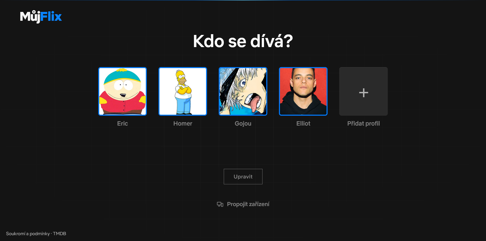
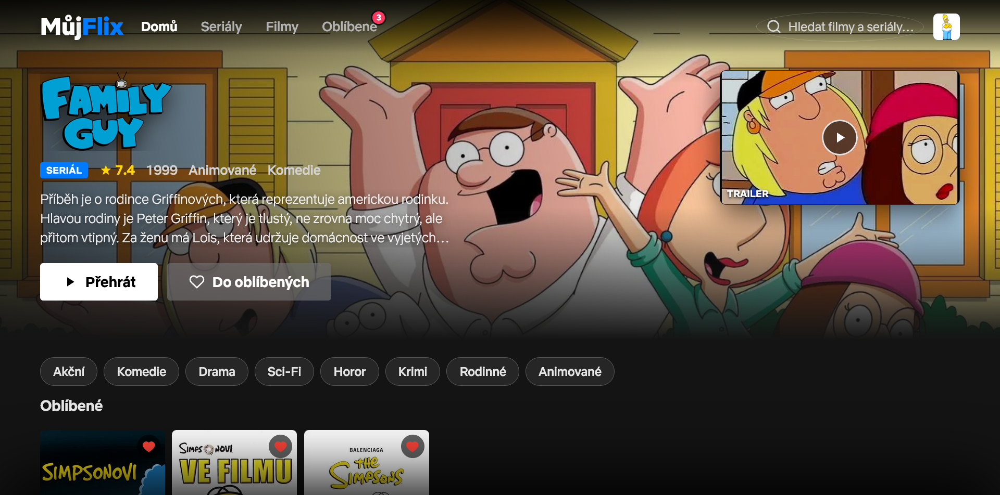
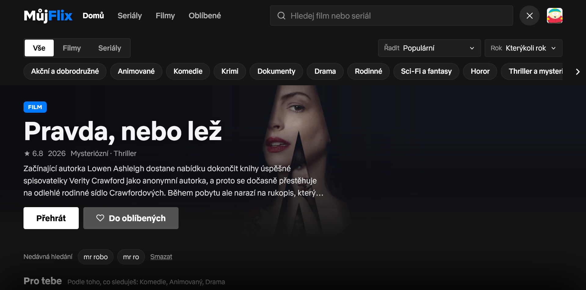
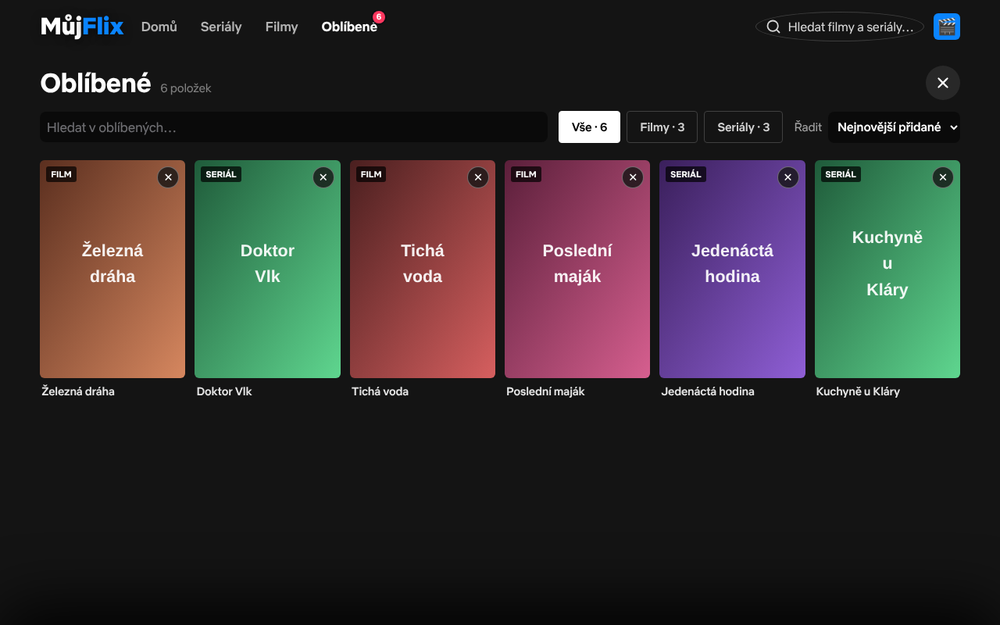
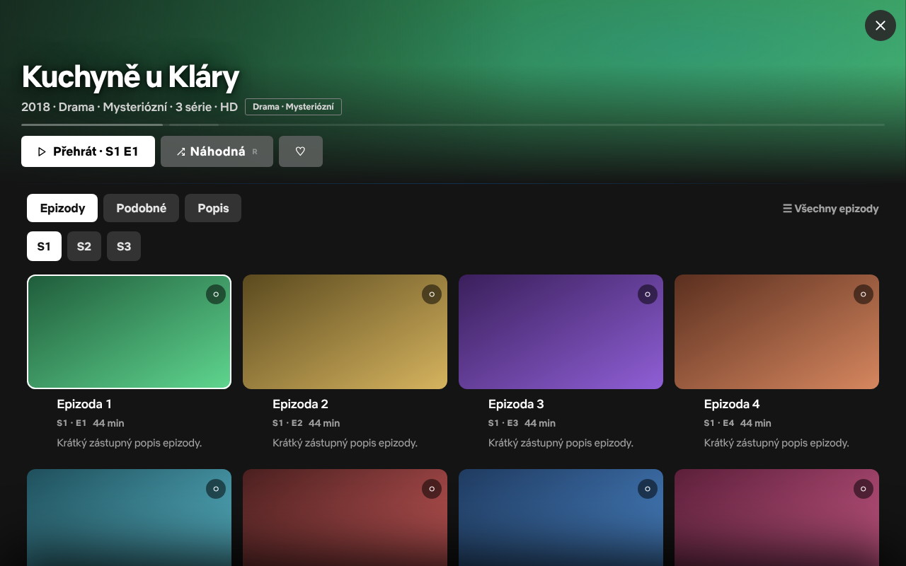
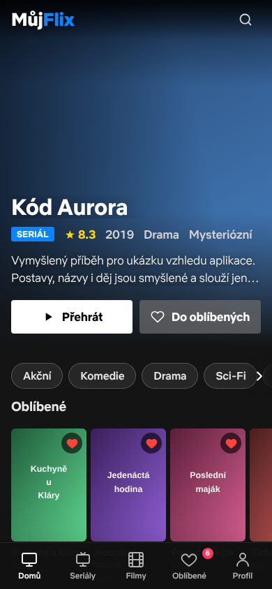
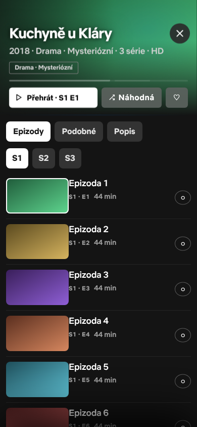

# 🎬 MůjFlix

**Osobní filmový a seriálový tracker ve stylu Netflixu.**
Najdi, co sledovat, pamatuj si, kde jsi skončil, a měj profily, hodnocení a seznamy na všech zařízeních.

---

## 👉 Jak začít

**Nic se neinstaluje a nic nemusíš spouštět.** Otevři v prohlížeči **<https://mujflix.pages.dev>**, vyber si nebo vytvoř profil a můžeš hledat, co sledovat. Funguje na telefonu, tabletu i počítači. Nepotřebuješ účet, e-mail ani heslo.

### Přidání na plochu (volitelné)

Z MůjFlixu se dá udělat „opravdová“ aplikace s vlastní ikonou:

| Zařízení | Jak |
|---|---|
| Android (Chrome) | menu ⋮ → **Přidat na plochu** / **Nainstalovat aplikaci** |
| iPhone / iPad (Safari) | tlačítko Sdílet → **Přidat na plochu** |
| Počítač (Chrome, Edge) | ikona instalace v adresním řádku |

---

## 📸 Jak to vypadá

<!-- Provizorní obrázky: smyšlené tituly a zástupné plakáty. Skutečné snímky z mujflix.pages.dev stačí přepsat pod stejným názvem v docs/screenshots/. -->

| Kdo se dívá? | Úvodní stránka |
|:-:|:-:|
|  |  |

| Procházení | Oblíbené |
|:-:|:-:|
|  |  |

| Detail seriálu | Na telefonu |
|:-:|:-:|
|  |   |

---

## ✨ Co MůjFlix umí

### 🏠 Úvodní stránka
- **Pokračovat ve sledování** – seriály i filmy, které jsi nedokoukal, s lištou postupu („S2 E5 · 43 %“). Klepnutí na seriál otevře výběr epizod, **▶** rovnou pustí další díl. Štítek **Nová epizoda** ti řekne, že vyšel další díl.
- **Vybráno pro tebe** a **Protože jsi viděl …** – doporučení podle toho, co sleduješ, hodnotíš a co ti přibylo do Oblíbených. Učí se zvlášť pro každý profil a nikam se neodesílají.
- **Top 10 tento týden**, populární tituly, novinky a řady podle žánrů.
- **Zvonek** s novinkami podle tvých oblíbených žánrů a **série dní** 🔥, kolik dní po sobě sis něco pustil.

### 🔎 Procházení a hledání
- **Seriály** a **Filmy** v horní liště (na telefonu ve spodní) otevřou procházení s filtry podle žánru a roku a řazením.
- **Hledání** (lupa nebo klávesa `/`) najde titul podle českého, anglického i původního názvu a pamatuje si, co jsi hledal.

### 📺 Detail seriálu
- **Epizody** – výběr sezóny, karty epizod s postupem. Klepnutí epizodu pustí, dlouhé podržení nabídne další akce (např. označit jako zhlédnutou).
- **Podobné** – seriály, které se ti můžou líbit.
- **Popis** – děj, fakta, **trailer** a **obsazení** (klepnutím na herce uvidíš jeho filmografii).

### ❤️ Oblíbené
- Srdíčko přidá titul do Oblíbených. Najdeš je pod **Oblíbené** v menu – s filtrem Vše / Filmy / Seriály, hledáním a řazením.
- U titulu můžeš dát **hodnocení** (milovaný / líbil se / ujde / nic moc). Doporučování se z něj učí.

### 🎞 Přehrávání
- Klepni na **Přehrát**. MůjFlix sám vybere zdroj, který titul má, a pamatuje si, který ti fungoval.
- Pod přehrávačem je výběr epizody, tlačítko **Další ›** (na konci seriálu i další seriál), hodnocení epizody a ikona **„kde to legálně sledovat“** (Netflix, Disney+, Max, SkyShowtime, Voyo …).
- **Dvě skupiny zdrojů:** česká vlajka = české a slovenské weby, přeškrtnutá vlajka = zahraniční (anglicky). Volba se pamatuje.
- Něco se nepřehrává? Klepni na **Zdroj nejde** – MůjFlix ho označí a zkusí další. U českých zdrojů pomůže i **lupa** (hledání titulu přímo na tom webu).
- Některé weby (Uzi.la, Movy, Cinejoy) nejde zobrazit uvnitř aplikace – místo toho se zobrazí tlačítko **Otevřít v novém okně**.

> ⚠️ **Reklamy:** přehrávané weby jsou cizí a mohou zobrazovat reklamy a vyskakovací okna. Doporučujeme blokátor reklam (třeba uBlock Origin) – appka v úvodních krocích nabídne ten pravý pro tvůj prohlížeč.

### 👤 Profily
- **Kdo se dívá?** – každý člen rodiny má vlastní profil se svým jménem, avatarem, barvou, seznamy, hodnocením a doporučováním.
- **PIN** (4 číslice) – kdo nemá znát PIN, se do profilu nedostane. Po 5 špatných pokusech se zámek na chvíli zablokuje a blokace se prodlužuje.
- **Věkové omezení** (do 7 / 12 / 15 let) – skryje tituly nad zvolený věk (podle hodnocení z TMDB; titul bez hodnocení se skryje).
- **Zaměření** – „Jen anime“ nebo oblíbené žánry (až 5).
- PIN a věkové omezení jsou **pojistka pro domácí použití**, ne skutečná rodičovská kontrola.

### 🔗 Propojení zařízení
Chceš mít profily, Oblíbené a postup sledování na telefonu i na počítači?
1. Na zařízení, kde už data máš, klepni na **profil vpravo nahoře → Propojit zařízení → Zobrazit kód**. Zobrazí se **šestimístný kód** (platí 10 minut) a QR kód.
2. Na druhém zařízení otevři totéž (je i na výběru profilu „Kdo se dívá?“), zvol **Mám kód** a kód zadej (nebo naskenuj QR).
3. Data se pak samy slučují – změny se stahují zhruba každých 45 sekund a při návratu do aplikace. Když jsi na obou zařízeních něco změnil, nic se neztratí.

Možnost „Propojit zařízení“ se zobrazí jen tehdy, když ji provozovatel zapnul. Kromě toho si můžeš **stáhnout zálohu** svých dat do souboru (`.json`) a později ji **načíst ze souboru**.

### ⌨️ Zkratky na počítači
`/` hledání · `Esc` zavře okno · v detailu seriálu šipky a `Enter` (přehrát) · `M` (označit epizodu jako zhlédnutou)

---

## ❓ Časté otázky

**Potřebuju účet nebo heslo?** Ne. Profily jsou jen ve tvém prohlížeči (nebo na zařízeních, která si propojíš kódem).

**Proč mi zmizely profily a Oblíbené?** Data jsou uložená v prohlížeči. Když smažeš „data webu“ / historii včetně úložiště, smažou se i ony. Proto si občas udělej **zálohu** (profil vpravo nahoře → Propojit zařízení → Stáhnout zálohu) nebo si zařízení propoj.

**Nenačítají se plakáty a řady jsou prázdné.** Zkontroluj připojení k internetu a stránku obnov. Když je výpadek na straně služby s daty o filmech (TMDB), zkus to za chvíli.

**Vidím starou verzi.** Appka sama ukáže lištu **„Je dostupná nová verze“** – klepni na **Obnovit**. Případně aplikaci na telefonu zavři a znovu otevři.

**Zdroj se nepřehrává.** Klepni na **Zdroj nejde**, zkus lupu nebo přepni na zahraniční skupinu zdrojů (přeškrtnutá vlajka). Weby se mění a občas jsou nedostupné – to MůjFlix nezpůsobuje.

**V přehrávači vyskakují reklamy.** Nainstaluj si blokátor reklam (viz výše). Reklamy jsou z cizích webů, ne z MůjFlixu.

**Co když jsem offline?** Zobrazí se stránka „Jsi offline“. K načtení titulů a plakátů je potřeba internet.

**Nezobrazuje se „Propojit zařízení“.** Tuhle funkci musí provozovatel nejdřív zapnout na serveru.

---

## 🛡 Soukromí

- Žádné účty, žádná reklama, žádné cookies ani analytika.
- Profily, Oblíbené, hodnocení a postup sledování jsou **jen ve tvém prohlížeči**. Pokud si zařízení propojíš, uloží se jejich kopie pod náhodným ID v úložišti provozovatele a po roce nečinnosti sama zmizí. Neukládá se tam PIN zámek ani aktivní profil.
- Metadata o filmech a seriálech jdou přes server provozovatele z [TMDB](https://www.themoviedb.org/); posílá se jen to, co hledáš nebo otevíráš.
- Přehrávání probíhá na cizích webech – platí jejich podmínky.
- Plné znění: [Soukromí a podmínky](soukromi.html).

## ⚠️ Důležité upozornění

MůjFlix je osobní tracker – **neposkytuje ani nehostuje žádný obsah** a nestahuje videa, jen tě navádí na streamovací služby a externí weby. Některé externí weby mohou nabízet obsah, který nemusí být v souladu s autorským právem ve tvé zemi. **Za to, co si pustíš, odpovídáš ty.** Pro legální sledování MůjFlix ukazuje, kde je titul dostupný na streamovacích službách.

---

## 🙏 Poděkování

- [TMDB](https://www.themoviedb.org/) – metadata filmů a seriálů. *Tento produkt využívá TMDB API, ale není jím schválen ani certifikován.*
- AniList, Wikipedie, TVmaze, Fandom, Wikidata – obrázky postav pro avatary
- [qrcode-generator](https://github.com/kazuhikoarase/qrcode-generator) (MIT) – QR kódy
- [Cloudflare Pages & Workers](https://pages.cloudflare.com/) – hosting a proxy
- AI agenti – programování

---

  <strong>🎬 MůjFlix</strong> 
  <em>Protože sledovat jen tak bez plánu je barbarství.</em>

